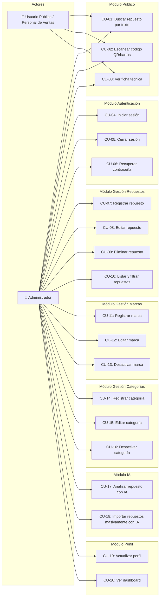

# Especificación de Casos de Uso — MotoVerify v2.0

**Fecha:** 27/08/2026  
**Versión:** 2.0  
**Proyecto:** MotoVerify — Plataforma de verificación y compatibilidad de repuestos de motocicletas  
**Autor:** Equipo de desarrollo MotoVerify

---

## Tabla de Contenidos

1. [Diagrama General de Casos de Uso](#1-diagrama-general-de-casos-de-uso)
2. [Actores del Sistema](#2-actores-del-sistema)
3. [Casos de Uso — Módulo Público](#3-casos-de-uso--módulo-público)
4. [Casos de Uso — Módulo de Autenticación](#4-casos-de-uso--módulo-de-autenticación)
5. [Casos de Uso — Módulo de Gestión de Repuestos](#5-casos-de-uso--módulo-de-gestión-de-repuestos)
6. [Casos de Uso — Módulo de Gestión de Marcas](#6-casos-de-uso--módulo-de-gestión-de-marcas)
7. [Casos de Uso — Módulo de Gestión de Categorías](#7-casos-de-uso--módulo-de-gestión-de-categorías)
8. [Casos de Uso — Módulo de Inteligencia Artificial](#8-casos-de-uso--módulo-de-inteligencia-artificial)
9. [Casos de Uso — Módulo de Perfil y Configuración](#9-casos-de-uso--módulo-de-perfil-y-configuración)

---

## 1. Diagrama General de Casos de Uso

---

## 2. Actores del Sistema

| Actor | Descripción | Nivel de acceso |
|---|---|---|
| **Usuario Público / Personal de Ventas** | Persona que accede a la plataforma para consultar información de repuestos, verificar compatibilidad y obtener datos precisos para el cliente. No requiere autenticación. | Solo lectura: búsqueda, escaneo QR, ficha técnica |
| **Administrador** | Persona responsable de gestionar todo el sistema: inventario de repuestos, marcas, categorías, y uso de herramientas de IA. Requiere autenticación con correo y contraseña. | Lectura y escritura: todas las funcionalidades |

---

## 3. Casos de Uso — Módulo Público

### CU-01: Buscar repuesto por texto

| Campo | Descripción |
|---|---|
| **ID** | CU-01 |
| **Nombre** | Buscar repuesto por texto en tiempo real |
| **Actor principal** | Usuario Público / Personal de Ventas |
| **Descripción** | El usuario escribe en la barra de búsqueda y el sistema muestra sugerencias de repuestos en tiempo real sin recargar la página |
| **Precondiciones** | El sistema está accesible y la base de datos disponible |
| **Postcondiciones** | Se muestra una lista de repuestos coincidentes con el texto buscado |
| **Componentes involucrados** | `public/index.php`, `controllers/qr_search.php`, `config/database.php` |

**Flujo principal:**

| Paso | Actor | Sistema |
|---|---|---|
| 1 | Accede a la página principal (`index.php`) | Carga la página con la barra de búsqueda |
| 2 | Escribe un texto en la barra de búsqueda (nombre, código interno o código de barras) | |
| 3 | | Ejecuta una consulta AJAX a la base de datos con cada tecla pulsada |
| 4 | | Muestra la lista de sugerencias debajo de la barra de búsqueda |
| 5 | Selecciona un repuesto de la lista | |
| 6 | | Redirige a la ficha técnica del repuesto seleccionado (CU-03) |

**Flujo alternativo:**

| Paso | Condición | Acción |
|---|---|---|
| 4a | No se encuentran coincidencias | El sistema muestra un mensaje indicando que no hay resultados |

---

### CU-02: Escanear código QR / código de barras

| Campo | Descripción |
|---|---|
| **ID** | CU-02 |
| **Nombre** | Buscar repuesto mediante escaneo de código QR o de barras |
| **Actor principal** | Usuario Público / Personal de Ventas |
| **Descripción** | El usuario activa la cámara del dispositivo, escanea un código y el sistema busca automáticamente el repuesto correspondiente |
| **Precondiciones** | El dispositivo tiene cámara funcional y el navegador ha otorgado permisos de acceso |
| **Postcondiciones** | El usuario es redirigido a la ficha técnica del repuesto encontrado |
| **Componentes involucrados** | `public/index.php`, `controllers/qr_search.php`, librería de escaneo QR |

**Flujo principal:**

| Paso | Actor | Sistema |
|---|---|---|
| 1 | Presiona el botón/ícono de escaneo QR en la página principal | |
| 2 | | Activa la cámara del dispositivo con la interfaz del escáner |
| 3 | Enfoca la cámara al código de barras o QR del repuesto | |
| 4 | | Detecta y decodifica el código automáticamente |
| 5 | | Envía el código a `qr_search.php` vía AJAX |
| 6 | | Busca en la BD un repuesto con `codigo_barras` o `codigo_interno` coincidente |
| 7 | | Redirige automáticamente a `ficha_tecnica.php?id=X` |

**Flujo alternativo:**

| Paso | Condición | Acción |
|---|---|---|
| 6a | El código no existe en la base de datos | El sistema muestra mensaje: "Repuesto no encontrado en el sistema" |
| 2a | No se otorgan permisos de cámara | El sistema muestra un mensaje solicitando permisos |

---

### CU-03: Ver ficha técnica del repuesto

| Campo | Descripción |
|---|---|
| **ID** | CU-03 |
| **Nombre** | Visualizar ficha técnica detallada del repuesto |
| **Actor principal** | Usuario Público / Personal de Ventas |
| **Descripción** | El usuario visualiza toda la información técnica de un repuesto específico: fotos, marca, categoría, descripción, características y compatibilidad |
| **Precondiciones** | El ID del repuesto existe en la base de datos |
| **Postcondiciones** | Se muestra la ficha técnica completa en formato catálogo profesional |
| **Componentes involucrados** | `public/ficha_tecnica.php`, `config/database.php` |

**Flujo principal:**

| Paso | Actor | Sistema |
|---|---|---|
| 1 | Accede a la ficha técnica (vía búsqueda, escaneo QR o enlace directo) | |
| 2 | | Lee el parámetro `id` de la URL (`ficha_tecnica.php?id=15`) |
| 3 | | Consulta la base de datos con el ID: fotos, marca, descripción, para qué motos sirve, características, disponibilidad |
| 4 | | Muestra la información en formato catálogo: foto principal, galería y detalles técnicos |
| 5 | Visualiza la información del repuesto | |

**Flujo alternativo:**

| Paso | Condición | Acción |
|---|---|---|
| 3a | El ID no existe en la BD | El sistema muestra mensaje amable: "Repuesto no encontrado" |

---

## 4. Casos de Uso — Módulo de Autenticación

### CU-04: Iniciar sesión

| Campo | Descripción |
|---|---|
| **ID** | CU-04 |
| **Nombre** | Iniciar sesión como administrador |
| **Actor principal** | Administrador |
| **Descripción** | El administrador ingresa sus credenciales (correo y contraseña) para acceder al panel de gestión |
| **Precondiciones** | El administrador está registrado en la tabla `ADMINISTRADOR` |
| **Postcondiciones** | Se crea una sesión PHP y se redirige al dashboard |
| **Componentes involucrados** | `public/index.php` (modal de login), `controllers/login_action.php`, `models/AdministradorModel.php` |

**Flujo principal:**

| Paso | Actor | Sistema |
|---|---|---|
| 1 | En la página principal, abre el modal de inicio de sesión | |
| 2 | Ingresa correo electrónico y contraseña | |
| 3 | Presiona el botón "Iniciar Sesión" | |
| 4 | | Recibe los datos vía POST y valida que no estén vacíos |
| 5 | | Busca en la BD al administrador por correo (`getByEmail`) |
| 6 | | Compara la contraseña ingresada con la almacenada usando `password_verify()` |
| 7 | | Crea la sesión: `$_SESSION['user_id']`, `$_SESSION['email']` |
| 8 | | Responde con `status: success` y URL de redirección al dashboard |
| 9 | | Redirige al dashboard (`views/admin/dashboard.php`) |

**Flujos alternativos:**

| Paso | Condición | Acción |
|---|---|---|
| 4a | Campos vacíos | Error: "Por favor complete todos los campos" |
| 5a | Correo no registrado | Error: "Usuario no encontrado" |
| 6a | Contraseña incorrecta | Error: "La contraseña es incorrecta" |

---

### CU-05: Cerrar sesión

| Campo | Descripción |
|---|---|
| **ID** | CU-05 |
| **Nombre** | Cerrar sesión del administrador |
| **Actor principal** | Administrador |
| **Descripción** | El administrador finaliza su sesión de forma segura |
| **Precondiciones** | El administrador tiene una sesión activa |
| **Postcondiciones** | La sesión es destruida y el usuario es redirigido a la página pública |
| **Componentes involucrados** | `controllers/logout.php` |

**Flujo principal:**

| Paso | Actor | Sistema |
|---|---|---|
| 1 | Presiona el botón "Cerrar Sesión" | |
| 2 | | Vacía la variable `$_SESSION` |
| 3 | | Destruye las cookies de sesión |
| 4 | | Ejecuta `session_destroy()` |
| 5 | | Redirige a `public/index.php` |

---

### CU-06: Recuperar contraseña

| Campo | Descripción |
|---|---|
| **ID** | CU-06 |
| **Nombre** | Recuperación de contraseña por correo electrónico |
| **Actor principal** | Administrador |
| **Descripción** | El administrador solicita un enlace de recuperación cuando olvida su contraseña |
| **Precondiciones** | El administrador tiene un correo registrado |
| **Postcondiciones** | La contraseña es actualizada con una nueva clave encriptada |
| **Componentes involucrados** | `controllers/forgot_action.php`, `public/reset_password.php` |

**Flujo principal:**

| Paso | Actor | Sistema |
|---|---|---|
| 1 | Selecciona la opción "Olvidé mi contraseña" | |
| 2 | Ingresa su correo electrónico | |
| 3 | | Verifica si la tabla `password_resets` existe; si no, la crea |
| 4 | | Busca si el correo está registrado en la BD |
| 5 | | Genera un token aleatorio seguro |
| 6 | | Almacena el token en la tabla `password_resets` |
| 7 | | Envía un correo con el enlace: `reset_password.php?token=XXXX` |
| 8 | | Muestra mensaje: "Si el correo existe, recibirás un enlace de recuperación" |
| 9 | Abre el enlace recibido por correo | |
| 10 | | Valida el token contra la BD |
| 11 | | Muestra el formulario para ingresar nueva contraseña |
| 12 | Ingresa la nueva contraseña | |
| 13 | | Encripta la nueva contraseña con bcrypt |
| 14 | | Actualiza la contraseña en la tabla `ADMINISTRADOR` |
| 15 | | Elimina el token de `password_resets` (uso único) |

**Flujos alternativos:**

| Paso | Condición | Acción |
|---|---|---|
| 4a | El correo no existe | El sistema muestra el MISMO mensaje genérico (seguridad anti-enumeración) |
| 10a | Token inválido o expirado | Error: "Enlace inválido o expirado" y se bloquea el formulario |

---

## 5. Casos de Uso — Módulo de Gestión de Repuestos

### CU-07: Registrar nuevo repuesto

| Campo | Descripción |
|---|---|
| **ID** | CU-07 |
| **Nombre** | Crear un nuevo repuesto en el inventario |
| **Actor principal** | Administrador |
| **Descripción** | El administrador registra un repuesto con toda su información técnica e imágenes |
| **Precondiciones** | Sesión de administrador activa. Debe existir al menos una marca y una categoría |
| **Postcondiciones** | El repuesto y sus imágenes quedan almacenados en la base de datos |
| **Componentes involucrados** | `views/admin/repuestos.php`, `controllers/repuestos_action.php`, `models/RepuestoModel.php`, `models/ImagenModel.php` |

**Flujo principal:**

| Paso | Actor | Sistema |
|---|---|---|
| 1 | En la sección de repuestos, presiona el botón "Nuevo" | |
| 2 | | Abre un formulario modal en blanco |
| 3 | Completa los campos: nombre, código de barras, código interno, marca, categoría, descripción, características | |
| 4 | Sube una o más fotografías del repuesto | |
| 5 | Presiona "Guardar" | |
| 6 | | Valida que los campos obligatorios no estén vacíos |
| 7 | | Verifica que el código de barras no esté duplicado (`checkCodigoBarras`) |
| 8 | | Verifica que el código interno no esté duplicado (`checkCodigoInterno`) |
| 9 | | Inserta el repuesto en la tabla `REPUESTO` y obtiene el ID generado |
| 10 | | Guarda las imágenes en `uploads/repuestos/` con nombre único |
| 11 | | Registra las imágenes en `IMAGEN` y las vincula en `REPUESTO_IMAGEN` |
| 12 | | Confirma: "Repuesto creado exitosamente" |

**Flujos alternativos:**

| Paso | Condición | Acción |
|---|---|---|
| 7a | Código de barras duplicado | Error: "El código de barras ya está registrado en otro repuesto" |
| 8a | Código interno duplicado | Error: "El código interno ya está registrado en otro repuesto" |

---

### CU-08: Editar repuesto existente

| Campo | Descripción |
|---|---|
| **ID** | CU-08 |
| **Nombre** | Modificar un repuesto existente |
| **Actor principal** | Administrador |
| **Descripción** | El administrador modifica la información de un repuesto ya registrado |
| **Precondiciones** | El repuesto existe en la base de datos y la sesión está activa |
| **Postcondiciones** | Los datos del repuesto son actualizados |
| **Componentes involucrados** | `views/admin/repuestos.php`, `controllers/repuestos_action.php`, `models/RepuestoModel.php` |

**Flujo principal:**

| Paso | Actor | Sistema |
|---|---|---|
| 1 | Presiona el ícono de edición (lápiz) en un repuesto existente | |
| 2 | | JavaScript extrae los datos actuales del repuesto y rellena automáticamente el formulario modal |
| 3 | Modifica los campos deseados | |
| 4 | Presiona "Guardar" | |
| 5 | | Detecta que hay un `repuesto_id` (modo edición, no creación) |
| 6 | | Valida que los códigos no estén duplicados (excluyendo el repuesto actual) |
| 7 | | Ejecuta `UPDATE` en la tabla `REPUESTO` |
| 8 | | Si se subieron nuevas imágenes, las procesa y vincula |
| 9 | | Confirma: "Repuesto actualizado exitosamente" |

---

### CU-09: Eliminar repuesto

| Campo | Descripción |
|---|---|
| **ID** | CU-09 |
| **Nombre** | Eliminar un repuesto del inventario |
| **Actor principal** | Administrador |
| **Descripción** | El administrador elimina permanentemente un repuesto y sus relaciones de imágenes |
| **Precondiciones** | El repuesto existe en la base de datos |
| **Postcondiciones** | El repuesto y sus relaciones de imágenes son eliminados de la BD |
| **Componentes involucrados** | `controllers/repuestos_action.php`, `models/RepuestoModel.php` |

**Flujo principal:**

| Paso | Actor | Sistema |
|---|---|---|
| 1 | Presiona el botón de eliminar en un repuesto | |
| 2 | | Solicita confirmación al usuario |
| 3 | Confirma la eliminación | |
| 4 | | Elimina las relaciones en `REPUESTO_IMAGEN` |
| 5 | | Elimina el repuesto de la tabla `REPUESTO` |
| 6 | | Confirma: "Repuesto eliminado exitosamente" |

---

### CU-10: Listar y filtrar repuestos

| Campo | Descripción |
|---|---|
| **ID** | CU-10 |
| **Nombre** | Listar repuestos con filtros y paginación |
| **Actor principal** | Administrador |
| **Descripción** | El administrador visualiza el inventario completo con opciones de filtrado por marca, categoría o texto, y paginación de 12 elementos por página |
| **Precondiciones** | Sesión activa |
| **Postcondiciones** | Se muestra la lista filtrada y paginada |
| **Componentes involucrados** | `views/admin/repuestos.php`, `config/database.php` |

**Flujo principal:**

| Paso | Actor | Sistema |
|---|---|---|
| 1 | Accede a la sección "Repuestos" | |
| 2 | | Calcula el total de repuestos y carga los primeros 12 |
| 3 | (Opcional) Selecciona filtros: marca, categoría o escribe texto | |
| 4 | | Filtra los resultados según los criterios seleccionados |
| 5 | (Opcional) Navega entre páginas | |
| 6 | | Carga el siguiente grupo de 12 repuestos |

---

## 6. Casos de Uso — Módulo de Gestión de Marcas

### CU-11: Registrar nueva marca

| Campo | Descripción |
|---|---|
| **ID** | CU-11 |
| **Nombre** | Crear una nueva marca de repuestos |
| **Actor principal** | Administrador |
| **Descripción** | El administrador registra una nueva marca (ej: Yamaha, Honda) con nombre, descripción y logotipo |
| **Precondiciones** | Sesión de administrador activa |
| **Postcondiciones** | La marca y su logotipo quedan registrados en la BD |
| **Componentes involucrados** | `views/admin/marcas.php`, `controllers/marcas_action.php`, `models/MarcaModel.php`, `models/ImagenModel.php` |

**Flujo principal:**

| Paso | Actor | Sistema |
|---|---|---|
| 1 | Presiona el botón "Añadir nueva marca" | |
| 2 | | Abre una ventana emergente con formulario |
| 3 | Ingresa nombre, descripción y sube la imagen del logo | |
| 4 | Presiona "Guardar" | |
| 5 | | Valida que el nombre no esté duplicado (`checkNameExists`) |
| 6 | | Guarda la marca en la tabla `MARCA` y obtiene el ID |
| 7 | | Guarda la imagen del logo en `uploads/marcas/` con nombre único (`marca_ID_timestamp.png`) |
| 8 | | Registra la imagen en `IMAGEN` y la vincula en `MARCA_IMAGEN` |
| 9 | | Confirma la creación exitosa |

**Flujo alternativo:**

| Paso | Condición | Acción |
|---|---|---|
| 5a | Nombre duplicado | Error: "Ya existe una marca con este nombre" |

---

### CU-12: Editar marca

| Campo | Descripción |
|---|---|
| **ID** | CU-12 |
| **Nombre** | Modificar una marca existente |
| **Actor principal** | Administrador |
| **Precondiciones** | La marca existe y la sesión está activa |
| **Postcondiciones** | Los datos de la marca son actualizados |

**Flujo principal:**

| Paso | Actor | Sistema |
|---|---|---|
| 1 | Presiona el botón de editar en una marca | |
| 2 | | Carga los datos actuales en el formulario |
| 3 | Modifica nombre, descripción o logo | |
| 4 | Presiona "Guardar" | |
| 5 | | Valida nombre no duplicado (excluyendo la marca actual) |
| 6 | | Actualiza los datos de la marca |
| 7 | | Si se cambió el logo, limpia la relación anterior (`limpiarRelacion`) y guarda el nuevo |

---

### CU-13: Desactivar marca

| Campo | Descripción |
|---|---|
| **ID** | CU-13 |
| **Nombre** | Desactivar una marca |
| **Actor principal** | Administrador |
| **Descripción** | La marca se desactiva (eliminación lógica) para proteger los repuestos asociados |
| **Precondiciones** | La marca existe en la BD |
| **Postcondiciones** | La marca cambia a estado inactivo |

---

## 7. Casos de Uso — Módulo de Gestión de Categorías

### CU-14: Registrar nueva categoría

| Campo | Descripción |
|---|---|
| **ID** | CU-14 |
| **Nombre** | Crear una nueva categoría de repuestos |
| **Actor principal** | Administrador |
| **Descripción** | El administrador crea una categoría para clasificar repuestos (ej: Motor, Frenos, Suspensión) |
| **Precondiciones** | Sesión activa |
| **Postcondiciones** | La categoría queda registrada en la tabla `CATEGORIA` |
| **Componentes involucrados** | `views/admin/catalogo.php`, `controllers/catalogo_action.php`, `models/CategoriaModel.php` |

**Flujo principal:**

| Paso | Actor | Sistema |
|---|---|---|
| 1 | Presiona "Añadir nueva categoría" | |
| 2 | | Abre ventana emergente con formulario |
| 3 | Ingresa nombre y descripción de la categoría | |
| 4 | Presiona "Guardar" | |
| 5 | | Valida nombre no vacío y no duplicado |
| 6 | | Inserta en tabla `CATEGORIA` |
| 7 | | Confirma la creación |

**Flujo alternativo:**

| Paso | Condición | Acción |
|---|---|---|
| 5a | Nombre duplicado | Error: "Ya existe una categoría con este nombre" |
| 5b | Nombre vacío | Error: "El nombre es obligatorio" |

---

### CU-15: Editar categoría

| Campo | Descripción |
|---|---|
| **ID** | CU-15 |
| **Nombre** | Modificar una categoría existente |
| **Actor principal** | Administrador |
| **Precondiciones** | La categoría existe y la sesión está activa |
| **Postcondiciones** | Los datos de la categoría son actualizados |

**Flujo principal:**

| Paso | Actor | Sistema |
|---|---|---|
| 1 | Presiona editar en una categoría | |
| 2 | | Carga datos actuales en el formulario |
| 3 | Modifica nombre y/o descripción | |
| 4 | Presiona "Guardar" | |
| 5 | | Verifica que la categoría exista por ID |
| 6 | | Valida que el nuevo nombre no esté en uso por otra categoría |
| 7 | | Actualiza los datos |

---

### CU-16: Desactivar categoría

| Campo | Descripción |
|---|---|
| **ID** | CU-16 |
| **Nombre** | Desactivar una categoría |
| **Actor principal** | Administrador |
| **Descripción** | La categoría se desactiva en lugar de eliminarse para no afectar repuestos existentes asociados |
| **Precondiciones** | La categoría existe |
| **Postcondiciones** | La categoría cambia a estado inactivo |

---

## 8. Casos de Uso — Módulo de Inteligencia Artificial

### CU-17: Analizar repuesto con IA (Google Gemini)

| Campo | Descripción |
|---|---|
| **ID** | CU-17 |
| **Nombre** | Reconocimiento visual de repuestos mediante Inteligencia Artificial |
| **Actor principal** | Administrador |
| **Descripción** | El administrador toma una foto de un repuesto desconocido. La IA de Google Gemini analiza la imagen e identifica el tipo de repuesto, la marca/modelo compatible y sugiere un nombre de búsqueda |
| **Precondiciones** | Sesión activa, cámara funcional, clave API de Gemini válida en `config/api.php` |
| **Postcondiciones** | Se muestra el análisis de la IA en pantalla |
| **Componentes involucrados** | `views/admin/dashboard.php` o `views/admin/repuestos.php` (modal de cámara), `controllers/ai_analyze.php`, `config/api.php` |

**Flujo principal:**

| Paso | Actor | Sistema |
|---|---|---|
| 1 | Presiona el botón de cámara/IA en el dashboard o sección de repuestos | |
| 2 | | Abre un modal con la cámara del dispositivo |
| 3 | Toma una fotografía del repuesto | |
| 4 | | Convierte la foto a formato Base64 |
| 5 | | Envía la imagen a `ai_analyze.php` vía AJAX |
| 6 | | El controlador obtiene la clave de Gemini de `config/api.php` |
| 7 | | Envía la foto a la API de Google Gemini con el prompt: *"Analiza esta imagen de un repuesto de motocicleta. Dime qué es, para qué marca o modelo podría servir y dame un nombre corto que pueda usar para buscarlo en mi inventario"* |
| 8 | | Recibe la respuesta de la IA |
| 9 | | Muestra el análisis en la interfaz del usuario |
| 10 | Revisa los resultados y puede usar la sugerencia para buscar o registrar el repuesto | |

**Flujo alternativo:**

| Paso | Condición | Acción |
|---|---|---|
| 6a | Clave API inválida | Error de autenticación con el servicio de IA |
| 7a | Fallo de conexión con la API | Error: "No se pudo conectar con el servicio de IA" |

---

### CU-18: Importar repuestos masivamente con IA (OpenAI)

| Campo | Descripción |
|---|---|
| **ID** | CU-18 |
| **Nombre** | Importación masiva de repuestos desde documentos mediante IA |
| **Actor principal** | Administrador |
| **Descripción** | El administrador sube una foto de factura o lista impresa. La IA de OpenAI lee el documento, extrae los datos de los repuestos en formato JSON, y el sistema permite al administrador revisar y guardar masivamente |
| **Precondiciones** | Sesión activa, clave API de OpenAI válida |
| **Postcondiciones** | Los repuestos extraídos se almacenan en la BD. Las marcas y categorías inexistentes se crean automáticamente |
| **Componentes involucrados** | `views/admin/repuestos.php`, `controllers/ai_import_action.php`, `controllers/bulk_insert_action.php`, `models/RepuestoModel.php`, `models/MarcaModel.php`, `models/CategoriaModel.php` |

**Flujo principal:**

| Paso | Actor | Sistema |
|---|---|---|
| 1 | Accede a la herramienta de importación con IA (`repuestos.php?ai_import=true`) | |
| 2 | Sube una foto de factura, lista impresa o archivo PDF | |
| 3 | | Envía el documento a `ai_import_action.php` |
| 4 | | Obtiene la clave de OpenAI de `config/api.php` |
| 5 | | Envía el documento a la API de OpenAI con instrucciones estrictas: responder SOLO en formato JSON con campos: nombre, codigo_interno, marca, caracteristicas |
| 6 | | Recibe la respuesta estructurada de la IA |
| 7 | | Muestra una tabla editable con los repuestos extraídos |
| 8 | Revisa y edita los datos si es necesario | |
| 9 | Selecciona los repuestos a guardar | |
| 10 | Presiona "Guardar Seleccionados" | |
| 11 | | Para cada repuesto, verifica si la marca existe; si no, la **crea automáticamente** |
| 12 | | Para cada repuesto, verifica si la categoría existe; si no, la **crea automáticamente** |
| 13 | | Guarda cada repuesto con `RepuestoModel->create(...)` |
| 14 | | Confirma: "X repuestos guardados exitosamente" |

**Flujo alternativo:**

| Paso | Condición | Acción |
|---|---|---|
| 5a | La IA no puede leer el documento | Se muestra un mensaje de error indicando que no se pudo procesar |
| 6a | La respuesta no está en formato JSON válido | Se muestra un error de procesamiento |

---

## 9. Casos de Uso — Módulo de Perfil y Configuración

### CU-19: Actualizar perfil del administrador

| Campo | Descripción |
|---|---|
| **ID** | CU-19 |
| **Nombre** | Actualizar información personal del administrador |
| **Actor principal** | Administrador |
| **Descripción** | El administrador actualiza su nombre, correo electrónico y/o contraseña con doble verificación de identidad |
| **Precondiciones** | Sesión activa |
| **Postcondiciones** | Los datos del perfil son actualizados en la tabla `ADMINISTRADOR` |
| **Componentes involucrados** | `views/admin/perfil.php`, `controllers/verify_password.php`, `controllers/perfil_action.php`, `models/AdministradorModel.php` |

**Flujo principal:**

| Paso | Actor | Sistema |
|---|---|---|
| 1 | Accede a la sección "Perfil" | |
| 2 | | Carga los datos actuales del administrador desde la BD |
| 3 | Modifica nombre, correo y/o contraseña | |
| 4 | Presiona "Guardar Cambios" | |
| 5 | | Abre un modal solicitando la contraseña actual |
| 6 | Ingresa su contraseña actual | |
| 7 | | Envía la contraseña a `verify_password.php` vía AJAX |
| 8 | | Busca al administrador por ID y compara con `password_verify()` |
| 9 | | Si es correcta: responde `status: success` |
| 10 | | Envía los datos actualizados a `perfil_action.php` |
| 11 | | Si hay nueva contraseña, la encripta con `password_hash()` |
| 12 | | Actualiza los datos con `AdministradorModel->updateProfile()` |
| 13 | | Confirma: "Perfil actualizado exitosamente" |

**Flujos alternativos:**

| Paso | Condición | Acción |
|---|---|---|
| 8a | Contraseña actual incorrecta | Error: "Contraseña incorrecta". Se bloquea el guardado |
| 11a | No se proporcionó nueva contraseña | Solo se actualizan nombre y correo (la contraseña no cambia) |

---

### CU-20: Ver dashboard administrativo

| Campo | Descripción |
|---|---|
| **ID** | CU-20 |
| **Nombre** | Visualizar el tablero principal del administrador |
| **Actor principal** | Administrador |
| **Descripción** | Al iniciar sesión, el administrador visualiza un resumen del inventario con marcas destacadas, últimos repuestos y accesos rápidos |
| **Precondiciones** | Sesión activa |
| **Postcondiciones** | Se muestra el dashboard actualizado |
| **Componentes involucrados** | `views/admin/dashboard.php`, `config/database.php` |

**Flujo principal:**

| Paso | Actor | Sistema |
|---|---|---|
| 1 | Inicia sesión o selecciona "Inicio" en el menú lateral | |
| 2 | | Verifica la sesión activa |
| 3 | | Consulta: las 7 marcas más importantes y los 6 últimos repuestos agregados |
| 4 | | Dibuja la barra de navegación lateral y la barra superior |
| 5 | | Muestra las marcas destacadas y los repuestos recientes en formato tarjeta |
| 6 | Visualiza el resumen y accede a las diferentes secciones | |

---

## Matriz de Trazabilidad: Caso de Uso → Requerimiento Funcional

| Caso de Uso | Requerimiento Funcional |
|---|---|
| CU-01: Buscar repuesto por texto | RF-01 |
| CU-02: Escanear código QR/barras | RF-02 |
| CU-03: Ver ficha técnica | RF-03 |
| CU-04: Iniciar sesión | RF-09 |
| CU-05: Cerrar sesión | RF-09 |
| CU-06: Recuperar contraseña | RF-10 |
| CU-07: Registrar repuesto | RF-04 |
| CU-08: Editar repuesto | RF-04 |
| CU-09: Eliminar repuesto | RF-04 |
| CU-10: Listar y filtrar repuestos | RF-04 |
| CU-11: Registrar marca | RF-05 |
| CU-12: Editar marca | RF-05 |
| CU-13: Desactivar marca | RF-05 |
| CU-14: Registrar categoría | RF-06 |
| CU-15: Editar categoría | RF-06 |
| CU-16: Desactivar categoría | RF-06 |
| CU-17: Analizar repuesto con IA | RF-07 |
| CU-18: Importar repuestos con IA | RF-08 |
| CU-19: Actualizar perfil | RF-11 |
| CU-20: Ver dashboard | RF-12 |

---

*Documento actualizado conforme al sistema MotoVerify implementado — Versión 2.0*
